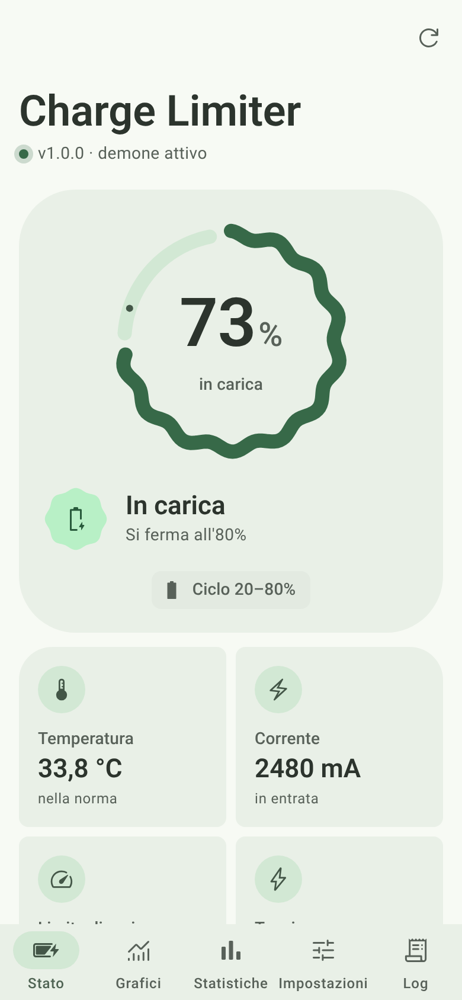
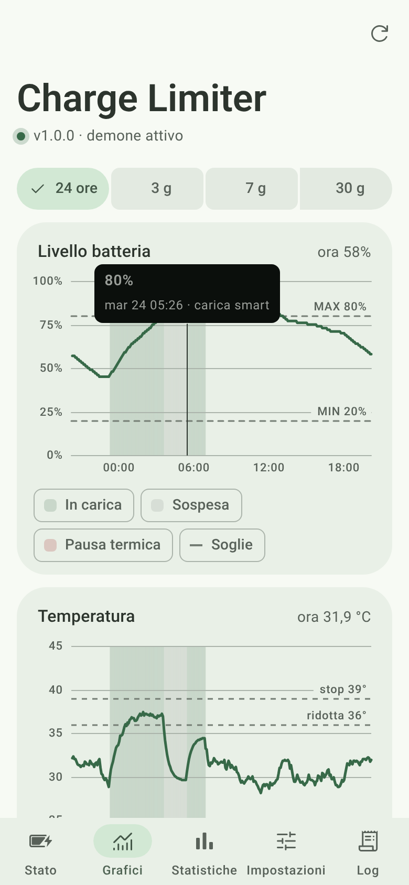
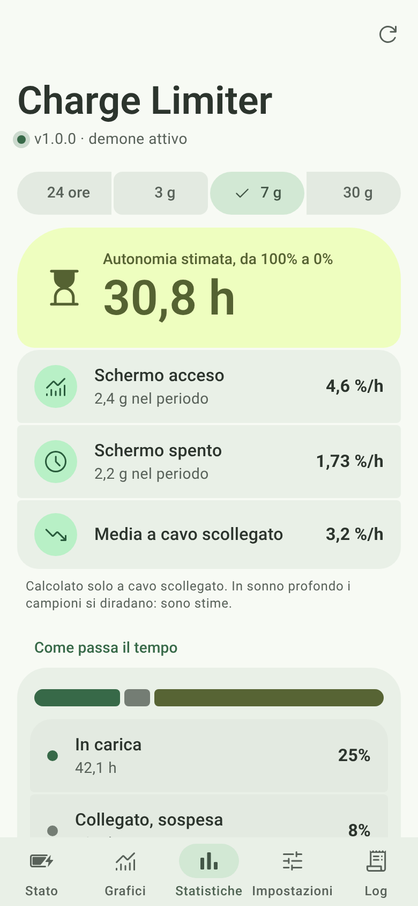
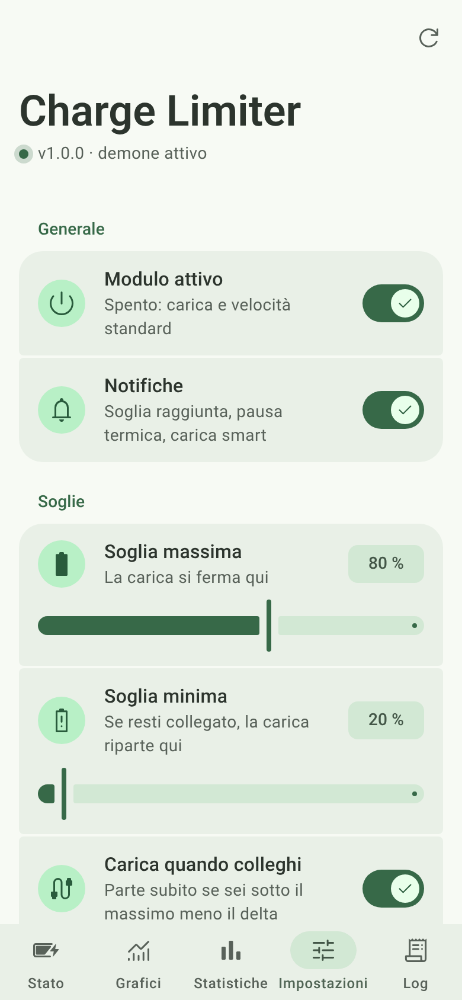
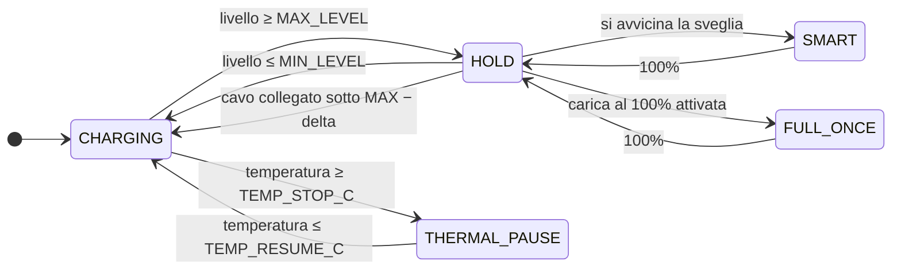
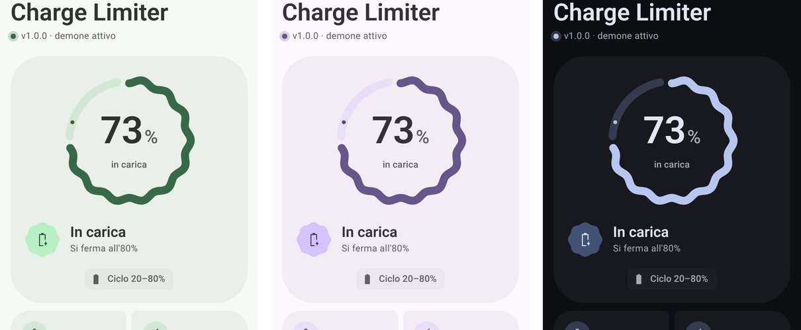

<div align="center">

# Veux Smart Charge Limiter

**Limite di carica intelligente per Redmi Note 11 Pro 5G (veux)**
Modulo Magisk / KernelSU / APatch con isteresi, corrente regolabile, protezione termica,
carica smart sulla sveglia, statistiche e WebUI.

[](https://github.com/zChronoX/VeuxChargeLimiter/releases/latest)
[](https://github.com/zChronoX/VeuxChargeLimiter/releases)
[](https://github.com/zChronoX/VeuxChargeLimiter/actions/workflows/ci.yml)
[](LICENSE)


   

<sub>La WebUI in stile Material 3 Expressive (screenshot con dati di esempio)</sub>

</div>

---

## Indice

- [Perché](#perché)
- [Funzionalità](#funzionalità)
- [Compatibilità](#compatibilità)
- [Installazione](#installazione)
- [Come funziona](#come-funziona)
- [Configurazione](#configurazione)
- [WebUI](#webui)
- [Pulsante Azione](#pulsante-azione)
- [Comandi da terminale](#comandi-da-terminale)
- [Statistiche](#statistiche)
- [Sicurezza](#sicurezza)
- [Domande frequenti e problemi](#domande-frequenti-e-problemi)
- [File e percorsi](#file-e-percorsi)
- [Sviluppo](#sviluppo)
- [Licenza](#licenza)

## Perché

Le batterie al litio invecchiano più in fretta quando restano a lungo vicino al 100%,
quando si scaldano e quando vengono caricate molto velocemente. Il Redmi Note 11 Pro 5G
carica fino a 67 W e la ROM non offre un limite di carica: questo modulo fa fermare la
carica a una soglia, ne limita la velocità e la sospende se la batteria si scalda.

## Funzionalità

| | |
|---|---|
| 🔋 **Ciclo con isteresi** | La carica si ferma alla soglia massima (default 80%) e riparte alla minima (default 20%), o subito quando colleghi il cavo. |
| ⚡ **Corrente limitata** | Default 2500 mA (~11 W): carica più fresca. `0` = velocità originale 67 W. |
| 🌡️ **Protezione termica a due livelli** | Sopra i 36 °C la corrente scende a 1500 mA; a 39 °C la carica si ferma e riparte sotto i 35 °C. |
| ⏰ **Carica smart** | Di notte resta all'80% e arriva al 100% giusto in tempo per la sveglia. |
| 💯 **100% una tantum** | Quando ti serve il telefono pieno: si disattiva da solo al 100% (o dopo 24 h). |
| 📊 **Statistiche** | Consumo a schermo acceso/spento, autonomia stimata, cicli equivalenti, storico della salute. |
| 📱 **WebUI Material 3 Expressive** | Stato live, grafici, statistiche, impostazioni e log, con i colori dinamici del tuo telefono. |
| 🔔 **Notifiche** | Soglia raggiunta, pausa termica, carica smart, batteria in emergenza. |
| 🛟 **Sicurezza** | Nulla viene toccato prima del boot completo; paracadute al 15%; si disattiva da solo se causa riavvii. |
| 🔄 **Aggiornamenti** | L'app root ti avvisa delle nuove versioni (`updateJson`). |

## Compatibilità

| | |
|---|---|
| **Telefono** | Redmi Note 11 Pro 5G, Redmi Note 11E Pro, POCO X4 Pro 5G (`veux`). Redmi Note 11 Pro+ 5G (`peux`) condivide la piattaforma ma non è stato provato. |
| **ROM** | Sviluppato e usato su **PixelOS 17**. Dovrebbe funzionare su qualsiasi ROM con il kernel di ricarica Xiaomi (`qcom_wt_chg`): verifica con `cli.sh probe` che esista `/sys/class/qcom-battery/input_suspend`. |
| **Root** | Magisk 20.4+ · KernelSU / KernelSU Next · APatch |
| **Pulsante Azione** | Magisk 28+ · KernelSU · APatch |

> [!NOTE]
> Su altri telefoni il modulo **non** funziona così com'è: i percorsi dei nodi del kernel
> sono specifici di questo modello.

## Installazione

1. Scarica `VeuxChargeLimiter-vX.Y.Z.zip` dall'[ultima release](https://github.com/zChronoX/VeuxChargeLimiter/releases/latest).
2. Apri Magisk / KernelSU / APatch → **Moduli** → **Installa da memoria** → scegli lo zip.
3. Riavvia.

Il demone parte circa 20 secondi dopo il boot completo. Le versioni successive arrivano
come aggiornamento direttamente nell'app root.

**Aggiornamenti:** installa la nuova versione sopra quella vecchia, senza disinstallare.
I tuoi valori vengono mantenuti e la configurazione si arricchisce delle eventuali nuove
opzioni (backup in `/sdcard/veux_charge_limiter.conf.bak`).

## Come funziona

Il modulo avvia un piccolo demone in shell che ogni 20–60 secondi legge livello,
temperatura e stato del cavo, e decide se la batteria deve caricare scrivendo sul nodo
del kernel `input_suspend` (1 = ingresso di corrente sospeso) e su
`constant_charge_current_max` (limite di corrente).



| Stato | Significato |
|---|---|
| `CHARGING` | In carica verso la soglia massima, con il limite di corrente. |
| `CHARGING_SOFT` | In carica a corrente ridotta perché la batteria è calda. |
| `HOLD` | Collegato, ma la carica è sospesa: il telefono usa la batteria. |
| `THERMAL_PAUSE` | Carica sospesa per temperatura alta. |
| `SMART` / `FULL_ONCE` | Carica verso il 100% (sveglia / una tantum). |
| `EMERGENCY` | Batteria ≤ 15%: carica sempre, a prescindere da tutto. |
| `UNPLUGGED` | Cavo scollegato. |
| `PAUSED` | Modulo in pausa (`ENABLED=0`): carica standard. |

> [!TIP]
> **Telefono sempre in carica?** Con `MIN_LEVEL=20` / `MAX_LEVEL=80` la batteria fa ogni giorno
> un ciclo profondo 80→20, perché `input_suspend` stacca completamente il caricatore.
> Per un telefono fisso sulla scrivania usa una forbice stretta, per esempio **75 / 80**.

## Configurazione

Puoi cambiare le impostazioni in tre modi, senza riavviare:

- dalla **WebUI** → Impostazioni;
- modificando **`/sdcard/veux_charge_limiter.conf`** con qualsiasi editor di testo
  (il demone lo rilegge appena cambia);
- da terminale: `cli.sh set MAX_LEVEL 85`.

| Opzione | Default | Descrizione |
|---|---|---|
| `ENABLED` | `1` | `0` = modulo in pausa, carica e velocità standard |
| `MAX_LEVEL` | `80` | Soglia (%) a cui la carica si ferma |
| `MIN_LEVEL` | `20` | Se resti collegato, la carica riparte qui. Minimo 15, almeno 5 sotto `MAX_LEVEL` |
| `CHARGE_ON_PLUG` | `1` | `1` = collegando il cavo sotto `MAX_LEVEL − PLUG_RESUME_DELTA` la carica parte subito |
| `PLUG_RESUME_DELTA` | `5` | Vedi sopra (con 80 e 5: carica se colleghi sotto il 75%) |
| `MAX_CHARGE_MA` | `2500` | Corrente massima in mA (500–12200). `0` = velocità originale |
| `TEMP_SOFT_C` | `36` | Sopra questa temperatura la corrente scende a `SOFT_CHARGE_MA`. `0` = disattivato |
| `SOFT_CHARGE_MA` | `1500` | Corrente ridotta (mA) |
| `TEMP_STOP_C` | `39` | La carica si ferma a questa temperatura (30–48 °C) |
| `TEMP_RESUME_C` | `35` | …e riprende sotto questa |
| `FORCE_FULL_ONCE` | `0` | `1` = carica fino al 100% una volta, poi torna da solo a `0` |
| `FORCE_FULL_EXPIRE_H` | `24` | Ore dopo cui la carica al 100% si annulla se non completata (`0` = mai) |
| `SMART_CHARGE` | `0` | `1` = carica smart attiva |
| `SMART_FIXED_TIME` | `0` | `0` = usa la sveglia dell'app Orologio; `HHMM` = orario fisso (es. `730` = 07:30) |
| `SMART_BUFFER_MIN` | `30` | Minuti di margine per arrivare al 100% in tempo |
| `NOTIFY` | `1` | Notifiche Android per gli eventi |
| `STATS_INTERVAL_MIN` | `5` | Ogni quanti minuti salvare un campione statistico (`0` = mai) |
| `POLL_CHARGING_SEC` | `25` | Intervallo di controllo in carica |
| `POLL_DISCHARGING_SEC` | `60` | Intervallo di controllo con carica sospesa |
| `POLL_UNPLUGGED_SEC` | `20` | Intervallo di controllo a cavo scollegato |

Valori fuori dai limiti vengono corretti automaticamente dal demone.

## WebUI

| Gestore root | Come aprirla |
|---|---|
| **KernelSU / APatch** | Tocca la scheda del modulo nella lista Moduli. |
| **Magisk** | L'app Magisk non mostra le WebUI: installa **[WebUI X](https://github.com/MMRLApp/WebUI-X-Portable)** oppure **[KsuWebUI Standalone](https://github.com/5ec1cff/KsuWebUIStandalone)**, concedi il root e apri il modulo da lì. |

Schede disponibili:

- **Stato**: anello di carica, stato, temperatura, corrente, limite, salute, azioni rapide.
- **Grafici**: livello, temperatura e corrente su 24 h / 3 / 7 / 30 giorni, con fasce di
  stato (in carica, sospesa, pausa termica) e soglie.
- **Statistiche**: consumo e autonomia, come passa il tempo, temperature in carica,
  storico salute.
- **Impostazioni**: tutte le opzioni, con controllo dei valori prima del salvataggio.
- **Log**: eventi recenti e analisi dei nodi del kernel.

### Design

L'interfaccia segue [Material 3 Expressive](https://m3.material.io/blog/building-with-m3-expressive),
l'evoluzione di Material Design introdotta con Android 16:

- **Colori dinamici**: su KernelSU, APatch e WebUI X usa la palette Monet fornita dal
  gestore root (`internal/colors.css`); su Magisk legge il colore del tema Android
  (`cli.sh theme`) e rigenera la palette con
  [Material Color Utilities](https://github.com/material-foundation/material-color-utilities).
  Senza nessuno dei due usa una palette verde di riserva. Chiaro e scuro seguono il sistema.
- **Forme**: scala di raggi Expressive, tile con angoli contrastanti, liste a segmenti come
  le Impostazioni di Android 16, e un badge di stato che cambia forma (sole in carica,
  biscotto in sospensione, esplosione in pausa termica…).
- **Componenti**: indicatore di carica circolare ondulato, barra di navigazione flessibile
  da 64 dp, gruppi di pulsanti connessi, pulsanti che cambiano forma alla pressione,
  interruttori con spunta, slider con maniglia a barra, toolbar flottante per salvare,
  indicatore di caricamento a forme che cambiano.
- **Movimento a molla**: le molle ufficiali dello schema Expressive convertite in curve CSS;
  con "Riduci animazioni" attivo le transizioni diventano immediate.

<p align="center"></p>

## Pulsante Azione

Il pulsante **Azione** nell'app root mostra lo stato e apre un menu rapido:

| Tasto | Effetto |
|---|---|
| **Volume su** | Attiva / annulla la carica al 100% una tantum |
| **Volume giù** | Mette in pausa / riattiva il modulo |
| *nessun tasto per 8 s* | Esce senza cambiare nulla |

## Comandi da terminale

Da un terminale root (Termux con `su`, `adb shell su`, …):

```sh
sh /data/adb/modules/veux_charge_limiter/cli.sh <comando>
```

| Comando | Cosa fa |
|---|---|
| `status` | Stato live (chiave=valore) |
| `config` | Configurazione attiva |
| `set CHIAVE VALORE [...]` | Modifica una o più opzioni (es. `set MIN_LEVEL 75 MAX_LEVEL 80`) |
| `toggle CHIAVE` | Inverte un'opzione 0/1 (es. `toggle FORCE_FULL_ONCE`) |
| `stats [giorni]` | Campioni statistici in CSV |
| `health` | Storico giornaliero della salute (CSV) |
| `log [righe]` | Ultime righe del log |
| `export` | Copia statistiche e storico in `/sdcard/VeuxChargeLimiter/` |
| `reset-stats` | Azzera statistiche e contatori |
| `probe` | Elenca i nodi di ricarica presenti nel kernel |
| `theme` | Colore e stile del tema Android (usato dalla WebUI su Magisk) |
| `restart` | Riavvia il demone |

## Statistiche

- **Campioni** (`stats.csv`): ogni 5 minuti salva ora, livello, corrente, tensione,
  temperatura, cavo, stato e schermo acceso/spento. Vengono tenuti circa 30 giorni.
- **Consumo**: calcolato solo sui periodi a cavo scollegato, separando schermo acceso e
  spento. Con il telefono in sonno profondo i campioni si diradano, quindi sono stime.
- **Cicli equivalenti**: somma delle percentuali caricate ÷ 100 (due cariche dal 50% al
  100% = 1 ciclo).
- **Salute**: una riga al giorno con SOH, capacità reale (`charge_full`) e contatore
  dei cicli del kernel.

Esporta tutto in CSV con il pulsante **Esporta CSV** o `cli.sh export`.

## Sicurezza

- **Nessun bootloop possibile per costruzione**: il modulo non usa `post-fs-data`, non
  modifica `/system` e scrive sui nodi del kernel solo dopo `sys.boot_completed` + 20 s.
- **Boot guard**: se il telefono si riavvia entro ~2 minuti dall'avvio del demone per
  3 volte di fila, il modulo si disattiva da solo.
- **Paracadute**: sotto il 15% la carica è sempre consentita.
- **Valori limitati**: corrente tra 500 e 12200 mA, stop termico tra 30 e 48 °C, soglie
  coerenti. Il kernel mantiene comunque le sue protezioni hardware.
- **Ripristino**: disattivando, mettendo in pausa o disinstallando il modulo, carica e
  corrente tornano ai valori originali.
- **Config su /sdcard al sicuro**: il file viene letto senza eseguirlo; solo chiavi note
  e solo numeri interi vengono accettati.

## Domande frequenti e problemi

<details>
<summary><b>Android dice "Collegato, non in carica": è normale?</b></summary>

Sì: è lo stato `HOLD`. Il caricatore è collegato ma l'ingresso di corrente è sospeso
perché hai raggiunto la soglia massima.
</details>

<details>
<summary><b>Non vedo le notifiche</b></summary>

Le notifiche arrivano dall'app di sistema **Shell**. Vai in Impostazioni → App → Shell →
Notifiche e abilitale. Puoi anche disattivarle con `NOTIFY=0`.
</details>

<details>
<summary><b>La carica smart dice "nessuna sveglia rilevata"</b></summary>

La sveglia viene letta da `dumpsys alarm` ogni 10 minuti, solo con il cavo collegato, e
solo per le sveglie impostate in un'app Orologio. Se la tua ROM o app non la espone,
imposta un orario fisso (`SMART_FIXED_TIME`, es. `700`).
</details>

<details>
<summary><b>La batteria supera di qualche punto la soglia massima</b></summary>

Il livello riportato dal kernel e il momento del controllo non sono perfettamente
allineati: 1% oltre la soglia è normale. Se lo sforamento è maggiore, abbassa
`POLL_CHARGING_SEC` e apri una issue con il log.
</details>

<details>
<summary><b>Il telefono sempre collegato scende fino al 20%</b></summary>

È il comportamento previsto con `MIN_LEVEL=20`: vedi il consiglio in
[Come funziona](#come-funziona) e usa per esempio 75 / 80.
</details>

<details>
<summary><b>Come disattivo tutto al volo?</b></summary>

Pulsante Azione → Volume giù, oppure WebUI → Metti in pausa, oppure disattiva il modulo
nell'app root. In tutti i casi la carica torna standard entro pochi secondi.
</details>

## File e percorsi

| Percorso | Contenuto |
|---|---|
| `/sdcard/veux_charge_limiter.conf` | Configurazione (modificabile) |
| `/sdcard/veux_charge_limiter.log` | Log degli eventi |
| `/sdcard/VeuxChargeLimiter/` | Esportazioni CSV |
| `/data/adb/veux_charge_limiter/` | Statistiche, contatori e stato interno (solo root) |
| `/data/adb/modules/veux_charge_limiter/` | Il modulo |

La disinstallazione ripristina i valori hardware e rimuove i dati interni; configurazione,
log ed esportazioni su `/sdcard` restano.

## Sviluppo

```
VeuxChargeLimiter/
├── module/                  # contenuto dello zip flashabile
│   ├── META-INF/            # installer Magisk
│   ├── module.prop
│   ├── customize.sh         # installazione e migrazione config
│   ├── service.sh           # avvio al boot + boot guard
│   ├── daemon.sh            # logica principale
│   ├── common.sh            # percorsi e funzioni condivise
│   ├── cli.sh               # comandi (usati da WebUI e Azione)
│   ├── action.sh            # pulsante Azione
│   ├── uninstall.sh
│   ├── config.conf          # configurazione predefinita
│   └── webroot/
│       ├── index.html       # WebUI (HTML, CSS e JS in un file)
│       └── mcu.min.js       # Material Color Utilities (palette dinamiche)
├── tools/
│   ├── build.sh             # crea dist/VeuxChargeLimiter-vX.Y.Z.zip
│   └── test/run-tests.sh    # test con sysfs simulato
├── docs/screenshots/
├── update.json              # usato dall'app root per gli aggiornamenti
└── CHANGELOG.md
```

```sh
tools/test/run-tests.sh   # test (richiede mksh e busybox)
tools/build.sh            # crea lo zip in dist/
```

I test avviano il vero `daemon.sh` su un finto `/sys` sia con **mksh** (la shell di
Android) sia con **BusyBox ash**, e verificano soglie, temperatura, carica smart, ciclo
di vita del demone, boot guard e migrazione della configurazione. La WebUI aperta in un
browser normale mostra dati di esempio.

Vuoi contribuire? Leggi [CONTRIBUTING.md](CONTRIBUTING.md).

## Licenza

Distribuito con licenza [GNU GPL v3.0](LICENSE).

Include componenti di terze parti con licenza Apache 2.0:
[Material Color Utilities](https://github.com/material-foundation/material-color-utilities)
(`module/webroot/mcu.min.js`) e le icone
[Material Symbols](https://github.com/google/material-design-icons) di Google.

> [!WARNING]
> Il modulo modifica parametri di ricarica del kernel. È pensato per essere prudente, ma
> lo usi a tuo rischio: l'autore non è responsabile di danni al dispositivo.
